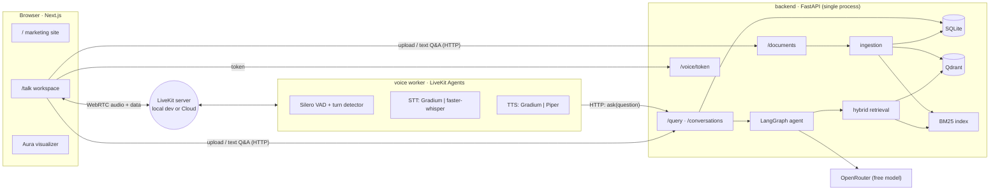
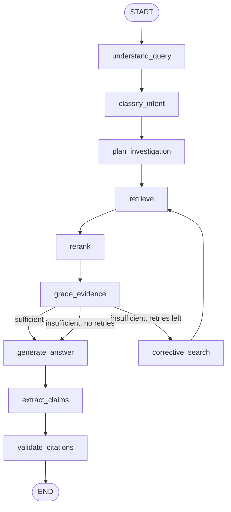

# Clai — Architecture

This document describes the system as built. Sections marked **(planned)** are not
implemented yet. [TASKS.md](TASKS.md) is the source of truth for status.

## System overview



### Why the voice worker calls the API

- **One brain.** Voice and text answers come from the same `/conversations/{id}/ask`
  code path, so there's no separate voice prompt or retrieval logic.
- **One Qdrant owner.** Qdrant *local mode* is an embedded store that only one
  process may open. The API process owns it, and the worker never touches storage.
- The worker stays a thin audio adapter: VAD, STT, a turn handler, TTS, and data
  messages for the evidence panel.

## Backend modules (`backend/app/`)

| Module | Responsibility |
|---|---|
| `config.py` | Pydantic Settings; validates env at startup |
| `main.py` | FastAPI app factory, CORS, error handlers, routers |
| `api/` | HTTP routes: health, documents, query, conversations, voice |
| `schemas/` | Pydantic request/response models (source of OpenAPI) |
| `ingestion/` | PDF validation, PyMuPDF extraction, structure + clause detection, chunking |
| `embeddings/` | sentence-transformers wrapper (`all-MiniLM-L6-v2`, 384-d) |
| `vector_db/` | Qdrant adapter (local path or remote URL), document-filtered search |
| `retrieval/` | BM25 index, RRF fusion, cross-encoder reranker, hybrid retriever |
| `agent/` | LangGraph state, nodes and graph; EvidencePack |
| `llm/` | OpenRouter client (timeouts, retries) and extractive fallback |
| `validation/` | Claim extraction and citation validation |
| `conversation/` | Conversation service, follow-up context, session summaries |
| `storage/` | SQLite repository and file store |
| `voice/` | LiveKit token minting, agent worker, local STT/TTS adapters |

## Ingestion pipeline

```
PDF bytes → validate (magic bytes, size, encrypted, page count)
         → PyMuPDF text with font metadata per page
         → detect headings (numbering patterns + font size/bold)
         → detect clauses (1., 1.1, (a), Article/Section N, ALL-CAPS headings)
         → image-only check (no extractable text → reject: OCR not supported)
         → provenance-aware chunks (never cross a clause; split long clauses by sentence)
         → embed (MiniLM-L6-v2) → upsert Qdrant (payload: document_id, page, section, clause…)
         → BM25 index per document (persisted as JSON)
         → status = ready
```

Every chunk carries `document_id, chunk_id, page_number, page_end, section, clause,
heading, text`. `section` and `clause` are `null` when they couldn't be detected;
they are never guessed.

## Agent graph



- `understand_query` resolves follow-ups ("what about them?") using the last turns.
- `classify_intent`, `plan_investigation`, `grade_evidence`, `extract_claims` and
  `validate_citations` are **deterministic**. They use no LLM call.
- `generate_answer` makes **at most one LLM call** per question, with structured JSON
  output `{answer, spoken_answer, key_points[], citations[chunk_id], sufficient}`.
  If there is no key, a timeout or a rate limit, an extractive fallback quotes the
  top evidence instead.
- `corrective_search` expands the query with agreement-domain synonyms (e.g.
  *terminate → termination, cancel, end, notice*), at most `AGENT_MAX_RETRIES`
  times (default 1).
- `validate_citations` drops citations to chunks not in the EvidencePack, checks each
  claim's lexical support, and marks the answer `grounded | partially_grounded |
  insufficient`.

## Voice pipeline

```
mic → LiveKit (WebRTC) → worker: Silero VAD → STT → turn detector
    → ask API (same agent) → spoken_answer → TTS → LiveKit → speaker
                          ↘ evidence JSON → LiveKit data topic "clai.evidence" → Evidence panel
```

- Agent states (`listening | thinking | speaking`) come from LiveKit's
  `lk.agent.state` participant attribute and drive the Aura.
- Barge-in uses LiveKit Agents' built-in interruption: user speech during TTS stops
  playback.
- Provider choice: `STT_PROVIDER=gradium|whisper`, `TTS_PROVIDER=gradium|piper`.

## Storage

| Data | Where | Deleted by `DELETE /documents/{id}` |
|---|---|---|
| Document metadata, status | SQLite `documents` | yes |
| Chunks (text + provenance) | SQLite `chunks` | yes |
| Vectors | Qdrant collection `clai_chunks`, filtered by `document_id` | yes |
| BM25 index | `data/bm25/{id}.json` | yes |
| Original PDF | `data/files/{id}.pdf` | yes |
| Conversations, messages, evidence refs, summaries | SQLite | yes (cascade) |

## Deployment shape

GitHub Pages hosts the static marketing site and a static build of `/talk`. That
build needs a reachable backend, and says so when there isn't one. The backend, the
voice worker and Qdrant run locally. See [docs/deployment.md](docs/deployment.md).
