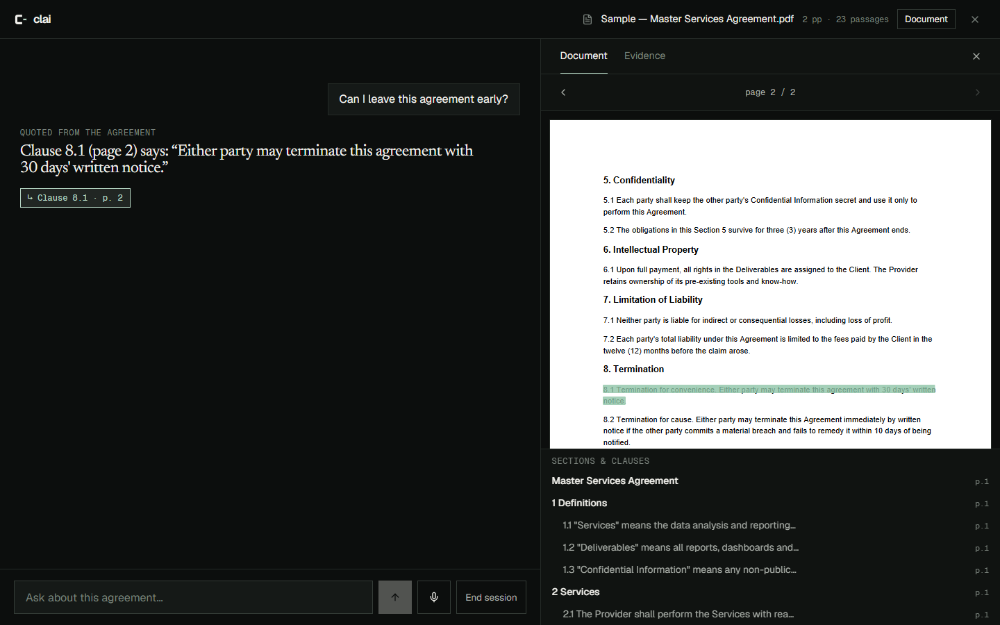
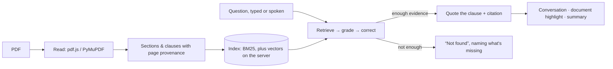

<p align="center">
  
</p>

<h3 align="center">Your agreement, explained.</h3>

<p align="center">
  Ask an agreement questions in plain language and see every answer traced back to the clause and page it came from.<br>
  The public version runs entirely in your browser. Nothing is uploaded.
</p>

<p align="center">
  <a href="https://sn3hhaa.github.io/clai/"><b>Open Clai</b></a> ·
  <a href="https://sn3hhaa.github.io/clai/docs/">Documentation</a> ·
  <a href="https://sn3hhaa.github.io/clai/technology/">Technology</a> ·
  <a href="https://sn3hhaa.github.io/clai/reference/">Developer reference</a>
</p>

<p align="center">
  <a href="https://github.com/sn3hhaa/clai/actions/workflows/ci.yml"></a>
  <a href="LICENSE"></a>
  
</p>



> Clai isn't legal advice. It shows what an agreement says and where it says it.

## What Clai does

- **Reads the agreement** you add: pages, sections and numbered clauses, with provenance.
- **Answers questions** in your own words by quoting the clause that settles them (*"leave early"* finds *termination for convenience*).
- **Shows its source**: clause, section and page, highlighted in the original PDF.
- **Says when it doesn't know**: *"It doesn't mention 'dress code'"*, instead of guessing.
- **Keeps context** for follow-ups, and **summarises** the session.
- **Voice**: speak questions and hear answers (Web Speech API in the browser; real-time LiveKit voice with a server).

## Two engines, one interface

| | Browser engine (public site) | Server engine (run it yourself) |
|---|---|---|
| Where | In the browser tab, on GitHub Pages | FastAPI on your machine |
| Parsing | pdf.js (Web Worker) | PyMuPDF |
| Retrieval | BM25 + intent expansion + RRF | Qdrant (MiniLM) + BM25 + RRF + cross-encoder |
| Reasoning | Coverage grading, one corrective round | LangGraph: grade, correct, validate citations |
| Answers | Quoted | Quoted, or written by an optional free LLM |
| Voice | Web Speech API | LiveKit, Silero VAD, Whisper (GPU/CPU), Piper, barge-in |
| Storage | Memory only | SQLite + Qdrant + files |

Both engines return the same answer shape, and `/talk` uses the server automatically when one is reachable.



## Measured (small, fictional test sets)

| | Browser engine | Server engine |
|---|---|---|
| Development set (23 questions, tuned on) | 100% on hit@1, citation, answer, abstention | hit@1 94.7%, hit@5 100%, citation 94.7%, answer 100%, abstention 100% |
| Held-out (12 questions, run once) | 8/12 correct; 4 declined with the right clause shown; 0 wrong citations; 3/3 refusals correct | not yet run |
| Voice | Depends on the browser's speech service | ≈2.1 s from end of question to speech (RTX 3050 laptop) |

The numbers show the pipelines work end to end; they're not a benchmark. Raw results are in [`evaluations/results`](evaluations/results).

## Repository

| Path | What |
|---|---|
| `frontend/` | Website and app (Next.js 16, static export to GitHub Pages) |
| `frontend/lib/engine/` | Browser engine (TypeScript) |
| `frontend/content/docs/` | On-site documentation (Markdown) |
| `backend/app/` | Server engine: ingestion, retrieval, LangGraph agent, API, LiveKit voice worker |
| `evaluations/` | Question sets and results for both engines |
| `assets/branding/` | Brand sources, generator and guidelines |
| `docs/` | Developer documentation (MkDocs), design audit, decision records |
| `scripts/` | `setup`, `dev`, `check` for PowerShell and bash |

## Development

The public site needs only Node. The server engine needs [uv](https://docs.astral.sh/uv/) and installs Python 3.12. No Docker.

```bash
git clone https://github.com/sn3hhaa/clai.git && cd clai

# Website + browser engine only
cd frontend && npm ci && npm run dev            # http://localhost:3000

# Everything, including the server engine and voice
./scripts/setup.sh && ./scripts/dev.sh          # Windows: .\scripts\setup.ps1; .\scripts\dev.ps1
```

| Task | Command |
|---|---|
| All checks | `scripts/check` (ruff, mypy, pytest, ESLint, tsc, Vitest, Playwright) |
| Browser engine tests + evaluation | `cd frontend && npx vitest run` |
| Server tests / evaluation | `cd backend && .venv/bin/python -m pytest` · `python -m scripts.evaluate` |
| Pages build | `STATIC_EXPORT=true NEXT_PUBLIC_BASE_PATH=/clai npm run export:pages` |
| Brand assets | `uv run --no-project --with fonttools python assets/branding/generate.py && npm run brand` |
| Walkthrough + screenshots | `node scripts/capture-media.mjs` then `uv run --no-project --with imageio-ffmpeg python scripts/encode-media.py` |

Configuration for the server engine is documented in [docs/configuration.md](docs/configuration.md).

## Testing

- **Backend:** 53 pytest tests (ingestion, retrieval, isolation, agent, API, voice adapters).
- **Frontend:** 30 Vitest tests, including the browser engine on the real fixture PDFs and both evaluations.
- **End to end:** 12 Playwright tests on desktop and mobile. They drive the real browser engine through upload → answer → citation → follow-up → refusal → summary, with no mocks.
- **Static export:** a crawler checks every route, client navigation and asset under `/clai/`.
- **CI:** all of the above on every push, with no API keys.

## Privacy

On the public site, the PDF, questions and answers stay in the browser tab; there's no server, no storage, no analytics. Voice input uses the browser's speech recognition, which may send audio to Google, Microsoft or Apple depending on the browser. Details: [privacy notice](https://sn3hhaa.github.io/clai/privacy/) and [SECURITY.md](SECURITY.md).

## Limitations

English, text-based PDFs only (no OCR or .docx yet) · clause numbers come from the document's own numbering · the browser engine matches wording, not meaning · voice depends on browser support · the server engine isn't hosted publicly (GitHub Pages is static).

## Roadmap

OCR for scanned agreements · comparing two agreements · .docx input · held-out evaluation of the server engine · streaming speech recognition. See [docs/roadmap.md](docs/roadmap.md).

## Contributing and license

Contributions are welcome: see [CONTRIBUTING.md](CONTRIBUTING.md), [RULES.md](RULES.md) and the [Code of Conduct](CODE_OF_CONDUCT.md). Code is [MIT](LICENSE). Fonts (Geist, Geist Mono, Newsreader) are under the SIL Open Font License. Piper (GPL-3.0) is used only as a separate program by the server engine.

Contact: [github.com/sn3hhaa](https://github.com/sn3hhaa) · [issues](https://github.com/sn3hhaa/clai/issues)
