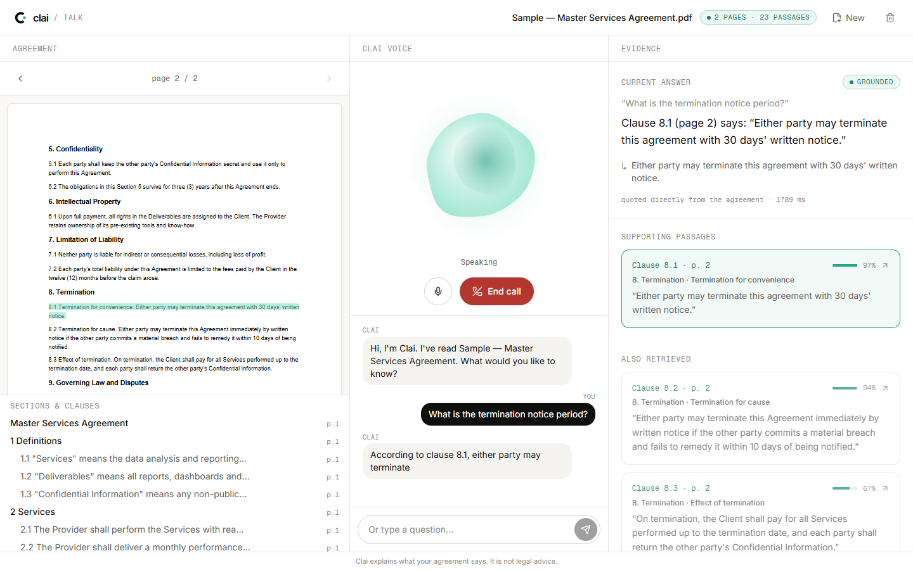
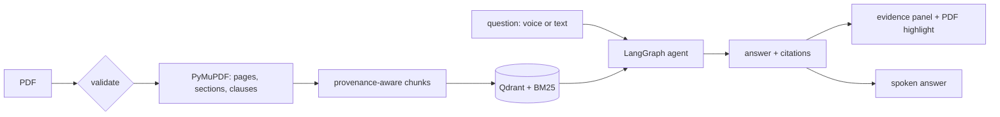
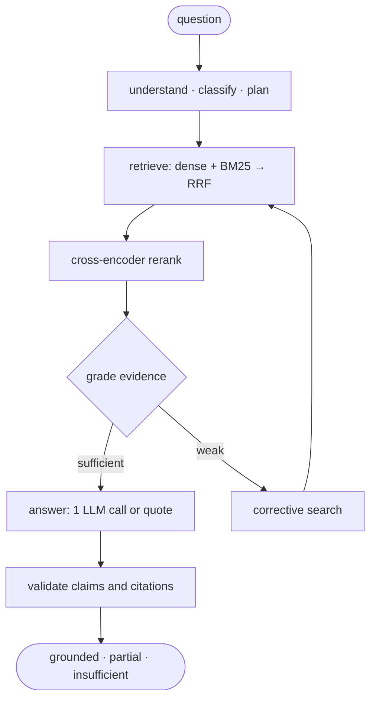
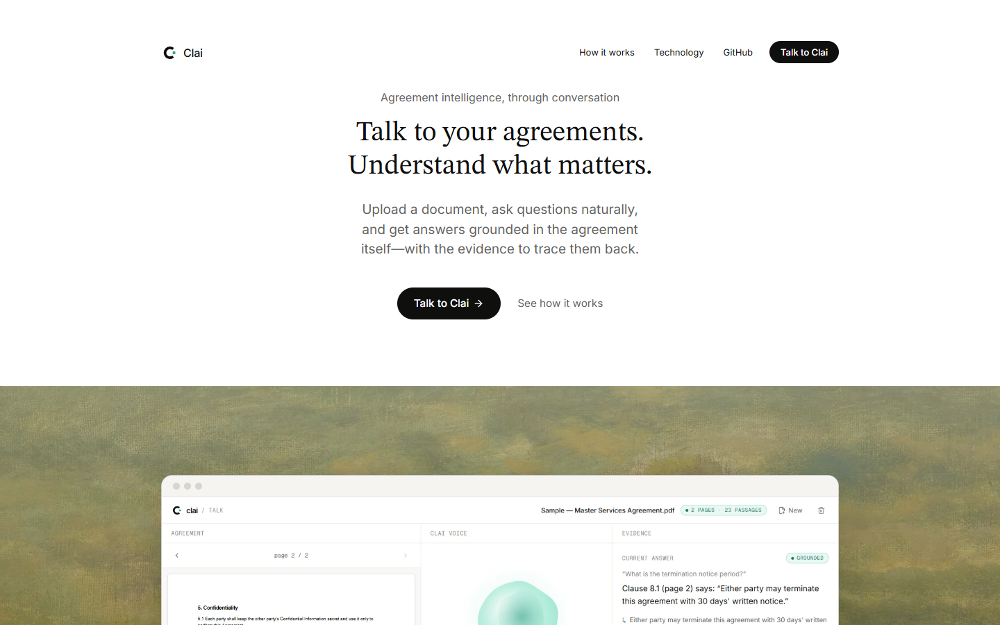
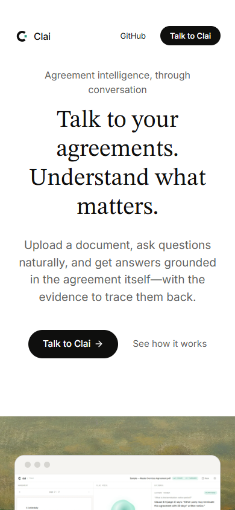

<p align="center">
  
</p>

<h3 align="center">Talk to your agreements. Understand what matters.</h3>

<p align="center">
  Voice-first agreement intelligence: upload a PDF, ask out loud, and hear answers grounded in the
  document, each with the page, section and clause it came from.
</p>

<p align="center">
  <a href="https://github.com/sn3hhaa/clai/actions/workflows/ci.yml"></a>
  <a href="LICENSE"></a>
  
  
  
</p>

<p align="center">
  <a href="https://sn3hhaa.github.io/clai/">Website</a> ·
  <a href="https://sn3hhaa.github.io/clai/docs/">Documentation</a> ·
  <a href="docs/installation.md">Install</a> ·
  <a href="docs/api/reference.md">API</a> ·
  <a href="ARCHITECTURE.md">Architecture</a>
</p>

---



> **Not legal advice.** Clai reports what an agreement says and where it says it.

## Why

People sign agreements they haven't really read, because the clauses that matter
(notice periods, renewals, liability caps, payment terms) are buried in legal prose.
Searching a PDF finds words, not answers. General chatbots answer confidently without
showing where the answer came from.

Clai reads one agreement and answers only from it. Every answer cites the passages it
used, every citation is checked against what was actually retrieved, and when the
agreement doesn't say, Clai says so.

## Features

- **Voice first.** A real-time LiveKit call with voice activity detection, turn
  detection, barge-in, local speech-to-text (faster-whisper, GPU when available) and
  text-to-speech (Piper). Gradium is optional.
- **Grounded answers.** Every answer cites page, section and clause. Click a citation
  and the clause is highlighted in the original PDF.
- **Hybrid retrieval.** MiniLM vectors in Qdrant plus BM25, fused with Reciprocal Rank
  Fusion and reranked by a local cross-encoder. Always scoped to one document.
- **An agent you can inspect.** A LangGraph state machine grades the evidence, runs a
  corrective search when it's weak, and validates every claim. It makes **at most one
  LLM call** per question, and without one it quotes the clause.
- **Abstains honestly.** "I couldn't find this in the agreement" when the evidence
  isn't there.
- **Session summaries.** Questions, key points, sources, unanswered questions and the
  transcript.
- **₹0 and private.** Free, local models by default. No Docker, no account, and your
  documents stay on your machine.

## How it works





**Voice:** browser ⇄ LiveKit (WebRTC) ⇄ voice worker (Silero VAD → Whisper → turn
detector → `POST /query` → Piper) ⇄ browser. The worker calls the same `/query` endpoint
as the text box, so there's one reasoning engine. Evidence travels to the page on a
LiveKit data stream. Details: [voice pipeline](docs/architecture/voice.md).

## Tech stack

| Layer | Technology |
|---|---|
| Frontend | Next.js 16 (App Router), TypeScript, Tailwind CSS 4, GSAP, pdf.js, `livekit-client` |
| Backend | FastAPI, Pydantic, SQLite |
| Documents | PyMuPDF |
| Retrieval | `sentence-transformers/all-MiniLM-L6-v2`, Qdrant (local mode), `rank-bm25`, RRF, `cross-encoder/ms-marco-MiniLM-L-6-v2` |
| Agent | LangGraph; OpenRouter (free models, optional) |
| Voice | LiveKit Agents 1.8, `livekit-server`, Silero VAD, turn-detector-v1-mini, faster-whisper, Piper |
| Quality | pytest, Vitest, Playwright, ruff, mypy, ESLint, GitHub Actions |

## Quick start

```powershell
git clone https://github.com/sn3hhaa/clai.git
cd clai
.\scripts\setup.ps1     # macOS/Linux: ./scripts/setup.sh
.\scripts\dev.ps1       # macOS/Linux: ./scripts/dev.sh
```

Open <http://localhost:3000/talk>, click **Try a fictional sample**, then **Start call**
and ask *"What is the termination notice period?"*

`setup` installs Python 3.12 with uv, pinned dependencies, local models,
`livekit-server` and Piper into `tools/`. Requirements and options:
[installation](docs/installation.md). Every setting: [configuration](docs/configuration.md).

| Command | What |
|---|---|
| `scripts/dev` | LiveKit, Piper, API (`:8000`), voice worker, frontend (`:3000`); logs in `logs/` |
| `scripts/dev -NoVoice` | API and frontend only (text questions) |
| `scripts/check` | ruff, mypy, pytest, ESLint, tsc, Vitest, Playwright |
| `cd backend; python -m scripts.evaluate` | retrieval and answer evaluation |

## API

`POST /documents` (upload) · `GET`/`DELETE /documents/{id}` · `POST /query` ·
`POST /conversations/{id}/end` (summary) · `POST /voice/token` · `GET /health`.
OpenAPI at `http://127.0.0.1:8000/docs`; reference in [docs/api](docs/api/reference.md).

## Testing and evaluation

- **Automated tests:** 53 backend (pytest), 18 frontend unit (Vitest), 12 end-to-end
  (Playwright, desktop and mobile). They use fictional agreements, real local models
  and a mocked LLM. CI needs no API keys.
- **Evaluation** on 23 labelled questions over the fictional fixtures (extractive mode):
  retrieval hit@1 **94.7%**, hit@5 **100%**, citation accuracy **94.7%**, answer
  correctness **100%**, abstention accuracy **100%**. The set is small, and fixes were
  developed on it, so treat these as a smoke test, not a benchmark.
  [Details](docs/evaluation.md).
- **Voice:** an automated synthetic caller and a Chrome fake-microphone run through the
  real `/talk` page both pass: question heard, clause 8.1 cited, answer spoken, summary
  saved. Measured ≈ 2.1 s from the end of the question to speech, on an RTX 3050
  laptop. The real-microphone [acceptance test](docs/guides/acceptance-test.md) still
  needs to be run by a person.

## Security and privacy

By default nothing leaves your machine. With an OpenRouter key, the question and the
retrieved passages go to OpenRouter. With Gradium selected, call audio goes to Gradium.
Keys stay server-side, LiveKit tokens expire after 15 minutes, and deleting a document
removes it from every store. Clai has no authentication and is meant for local use.
See [SECURITY.md](SECURITY.md) and [docs/security.md](docs/security.md).

## Limitations

No OCR (scanned PDFs are rejected) · PDF only · English only · single user · no hosted
backend (GitHub Pages serves the website; the app runs locally) · clause detection
depends on numbering · the free LLM tier allows 50 requests/day.
[Roadmap](docs/roadmap.md).

## Screenshots

| Website | Mobile |
|---|---|
|  |  |

## Contributing

See [CONTRIBUTING.md](CONTRIBUTING.md), [RULES.md](RULES.md) and the
[Code of Conduct](CODE_OF_CONDUCT.md). Please report security issues privately
([SECURITY.md](SECURITY.md)).

## License and credits

Code: [MIT](LICENSE). Third-party models, libraries and tools keep their own licences;
Piper is GPL-3.0 and runs as a separate program. Fonts: Geist, Geist Mono, Inter and
STIX Two Text (SIL Open Font License). Painting on the website: George Inness,
*Landscape* (1884 or 1889), The Metropolitan Museum of Art, public domain.

Made by [sn3hhaa](https://github.com/sn3hhaa).
