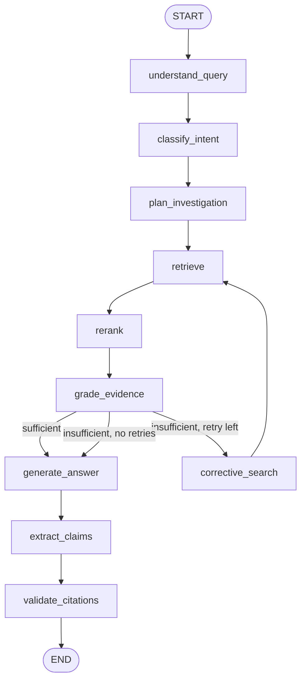

# LangGraph agent

`backend/app/agent/graph.py` builds a typed `StateGraph`. Every node is timed, and the
timings are returned in `AnswerOut.timings_ms`.



| Node | Does | LLM? |
|---|---|---|
| `understand_query` | resolves follow-ups ("and if they breach it?") by attaching the previous question | no |
| `classify_intent` | keyword rules → termination, payment, duration, liability, … | no |
| `plan_investigation` | the question, plus an intent expansion | no |
| `retrieve` | hybrid retrieval, merged with earlier rounds | no |
| `rerank` | cross-encoder; after a corrective search, max over question and rewrite | no |
| `grade_evidence` | top score ≥ 0.5, or ≥ 0.1 with ≥ 50% term overlap | no |
| `corrective_search` | rewrites with agreement synonyms (*quit → terminate, notice*), at most `AGENT_MAX_RETRIES` | no |
| `generate_answer` | one structured JSON call to OpenRouter over numbered sources; otherwise quotes the top clause | **at most one** |
| `extract_claims` | splits the answer into sentence claims | no |
| `validate_citations` | drops citations to passages that weren't retrieved; a claim is supported only if every number it states appears in the cited text and ≥ 50% of its terms do | no |

The result is labelled `grounded`, `partially_grounded` or `insufficient`.

## Prompt contract (LLM mode)

The model sees only numbered sources (`[S1] (page 2, clause 8.1, heading) text`) and the
last two turns. It must return:

```json
{"answer": "...", "spoken_answer": "...", "key_points": ["..."], "citations": ["S1"], "sufficient": true}
```

Source labels are mapped back to chunk IDs, and unknown labels are dropped. If the
model says `sufficient: false` and cites nothing, Clai abstains.
