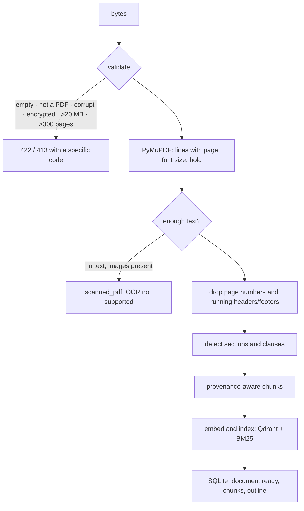

# PDF ingestion

`POST /documents` runs this pipeline synchronously. A typical agreement takes a few
seconds on a laptop CPU.

## Structure detection (`ingestion/structure.py`)

A line starts a new unit only at a **sentence boundary**, meaning the previous text
ended with `.`, `:` or `;`, or the line is bold. That rule stops wrapped lines such as
"(12) months unless…" from being read as clause `(12)`. Recognised patterns:

| Pattern | Example | Result |
|---|---|---|
| Article/Section/Clause N | `Section 7 Termination` | section + clause `7` |
| Top-level number with `.` or `)` | `8. Termination` | section `8. Termination` |
| Multi-level number | `8.1 Termination for convenience. Either…` | clause `8.1`, heading from the inline title |
| Sub-clause | `(a) …` after clause 8.2 | clause `8.2(a)` |
| ALL CAPS or bold short line | `GENERAL TERMS` | section heading |

Anything not matched stays `null`. **Section and clause labels are never guessed.**

## Chunks

Chunks never cross a unit boundary. Long clauses split at sentence boundaries into
chunks of 900 characters or fewer, and every chunk keeps:

`document_id, chunk_id, order, page_number, page_end, section, clause, heading, text`

The text that gets embedded and BM25-indexed is `"{section} {heading}. {text}"`, so
short clauses keep their context. The stored `text` is the original wording.

## Known limits

- No OCR: image-only PDFs are rejected with `scanned_pdf`.
- Tables come through as plain text lines.
- Numbering schemes beyond those above (e.g. `§ 4`, `4-1`) produce passages without
  clause labels. They are still searchable.
