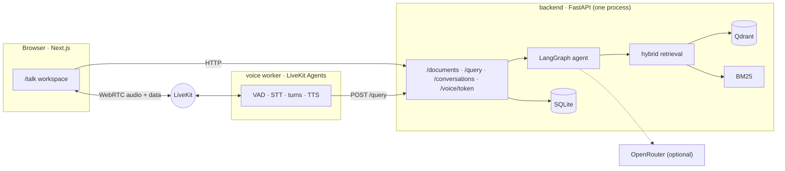

# System architecture

## Principles

- **One reasoning engine.** Voice and text both go through `POST /query`. The voice
  worker is an audio adapter. It has no retrieval logic and no access to storage.
- **One owner for storage.** Qdrant's local mode is an embedded store that only one
  process can open. The API process owns SQLite, Qdrant, BM25 and the PDFs.
- **Deterministic where possible.** Query understanding, intent, grading, claim
  extraction and citation validation are plain code. At most one LLM call is made per
  question, and it's optional.
- **Fail into something honest.** No LLM key, a timeout or a rate limit means a quoted
  clause. Too little evidence means "I couldn't find this in the agreement". A
  one-word voice fragment means "could you repeat that?".

## Backend modules (`backend/app/`)

| Module | Responsibility |
|---|---|
| `config.py` | validated settings |
| `main.py`, `api/routes.py` | app factory, CORS, error schema, routes |
| `schemas/` | Pydantic models (source of the OpenAPI schema and the TS types) |
| `ingestion/` | `pdf.py` validation + extraction, `structure.py` clauses + chunks |
| `embeddings/`, `vector_db/` | MiniLM embedder, Qdrant adapter |
| `retrieval/` | BM25, RRF, cross-encoder, hybrid retriever |
| `agent/` | `query.py` understanding, `graph.py` LangGraph, `answer.py` generation |
| `llm/` | OpenRouter client |
| `validation/` | claim support and citation checks |
| `storage/` | SQLite repository and file store |
| `services.py` | wires everything; ingest, ask, conversations, summaries |
| `voice/` | token minting, LiveKit worker, Whisper STT, Piper TTS, the API bridge |

## Frontend (`frontend/`)

| Path | What |
|---|---|
| `app/page.tsx`, `components/home/` | the website |
| `app/talk`, `components/talk/` | workspace: voice panel, evidence panel, session summary |
| `components/documents/` | uploader, pdf.js viewer with evidence highlighting |
| `components/voice/aura.tsx` | the Aura (canvas, original implementation) |
| `lib/api/` | typed API client mirroring `backend/app/schemas` |
| `lib/voice-state.ts` | maps LiveKit connection and agent state to Aura states |

## Storage and deletion

`DELETE /documents/{id}` removes the document's vectors (Qdrant, filtered by
`document_id`), its BM25 index file, the PDF, and its SQLite rows. Chunks,
conversations and messages cascade.
