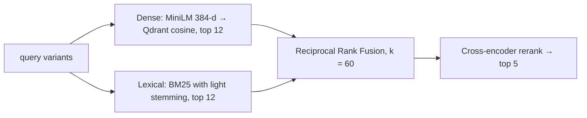

# Hybrid retrieval

Every stage is filtered to **one `document_id`**. The tests check that a question asked
of one agreement never returns another agreement's clauses.

| Stage | Implementation | Why |
|---|---|---|
| Dense | `sentence-transformers/all-MiniLM-L6-v2` in Qdrant | matches meaning: "end the contract" ≈ "terminate" |
| Lexical | `rank-bm25` on stemmed tokens, stopwords removed | matches exact terms, numbers, defined words |
| Fusion | RRF: `score = Σ 1/(60 + rank)` | combines rankings without calibrating scores |
| Rerank | `cross-encoder/ms-marco-MiniLM-L-6-v2`, sigmoid to [0, 1] | reads question and passage together |

The agent sends 1–2 query variants: the question itself, plus an intent expansion such
as `termination terminate notice period…`. Each variant runs both searches, and every
ranking goes into one RRF.

## Paraphrases and the reranker

The MS MARCO cross-encoder scores literal matches highly, but scores paraphrases very
low: "Is there a cap on liability?" gets 0.006 against the clause that answers it. After
a **corrective search**, the reranker therefore scores each passage against both the
question and the corrective rewrite (the question plus agreement synonyms such as
*cap → limitation of liability*) and keeps the higher score. Unanswerable questions
have no such vocabulary, so they stay near zero. See [Evaluation](../evaluation.md).

## Qdrant modes

| `QDRANT_MODE` | What it is |
|---|---|
| `local` (default) | `qdrant-client`'s embedded store on disk. This is **not** a Qdrant server; only one process may open it, which is why the API owns it. |
| `remote` | a Qdrant server (the native binary, no Docker) or Qdrant Cloud's free tier, via `QDRANT_URL` |
| `memory` | in-process, used by tests and the evaluation |
