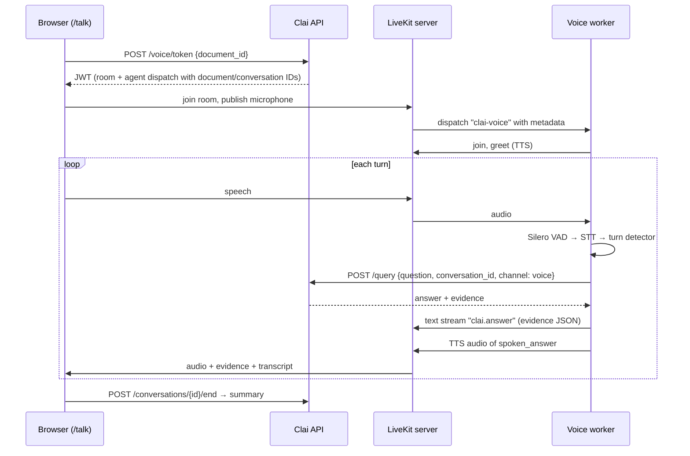

# Voice pipeline

## Components

| Piece | Default | Alternative |
|---|---|---|
| Transport | `livekit-server --dev` (local binary) | LiveKit Cloud free plan |
| VAD | Silero (local) | — |
| Turn detection | LiveKit `turn-detector-v1-mini` (local) | — |
| STT | faster-whisper `base.en`, GPU if available | Gradium (`STT_PROVIDER=gradium`) |
| TTS | Piper `en_US-lessac-medium` over HTTP | Gradium (`TTS_PROVIDER=gradium`) |
| "LLM" | `ClaiBackendLLM`: calls `POST /query` | — |

`ClaiBackendLLM` is a LiveKit `llm.LLM` whose completion is a call to Clai's own API.
LiveKit's session needs an LLM to generate replies, and this keeps one reasoning engine
for voice and text.

## Turn-taking decisions

- **Barge-in** is VAD-based (`interruption.mode = "vad"`). The adaptive mode needs
  LiveKit Cloud inference.
- **Every interruption is treated as real** (`resume_false_interruption = false`).
  Whisper here isn't streaming: a transcript only exists after the utterance ends, so a
  2–3 s question would exceed the false-interruption timeout and be thrown away.
- **One-word transcripts** ("Period.") get "could you ask the whole question again?"
  rather than an answer. Under CPU load, STT can catch only the tail of a question.
- During the first 3 s of agent speech, LiveKit's echo-cancellation warm-up ignores
  user audio, so the agent doesn't hear its own greeting.

## The Aura

`components/voice/aura.tsx` is an original canvas visualiser, **not** LiveKit's Agents
UI component. In `/talk` its state comes from `useVoiceAssistant().state` and the
connection state (`lib/voice-state.ts`). Its motion comes from `useTrackVolume`: the
microphone while listening, the agent's track while speaking. The homepage instance is
labelled as a demonstration with simulated audio.

## Measured latency

On the development laptop (Intel i5-14450HX, RTX 3050 6 GB, Windows 11, everything
local, warm), the automated voice check measured **≈ 2.1 s from the end of the spoken
question to the start of the agent's speech**. Clai's engine took about 0.1 s of that;
the rest is end-of-turn detection, STT and TTS. On CPU-only Whisper, STT alone took
≈ 2.5 s for a 2.6 s question. With the Next.js dev server compiling at the same time,
the pipeline fell behind real time; see [Troubleshooting](../guides/troubleshooting.md).
