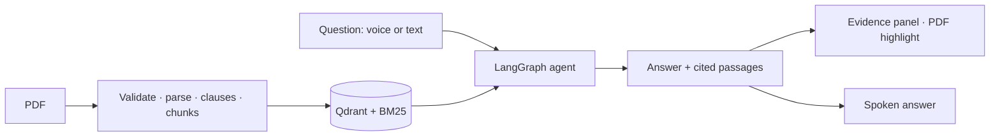

# Clai documentation

**Clai — Voice-First Agreement Intelligence.** Upload a PDF agreement, ask questions by
voice or text, and get short answers grounded in the document, each with the page,
section and clause it came from.

Clai is open source (MIT) and built to run on your own machine at no cost: no Docker,
no paid services. It is **not legal advice**.

## What's here

| If you want to… | Read |
|---|---|
| Run Clai | [Installation](installation.md), then [Configuration](configuration.md) |
| Understand the system | [Architecture](architecture/overview.md) and the [decision records](decisions/0001-qdrant-without-docker.md) |
| Call the API | [API reference](api/reference.md) (also live at `http://127.0.0.1:8000/docs`) |
| Check quality | [Testing](guides/testing.md), [Evaluation](evaluation.md), [Voice acceptance test](guides/acceptance-test.md) |
| Know the limits | [Security & privacy](security.md), [Limitations & roadmap](roadmap.md) |

## The pipeline in one picture

